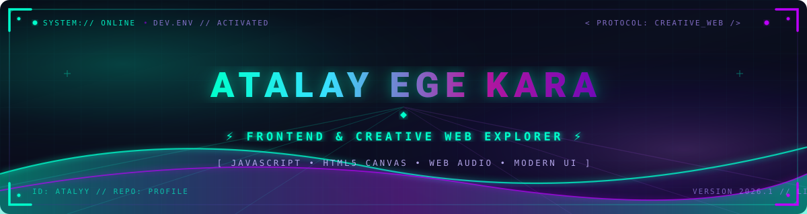

  <!-- Cyberpunk Dalgalı Karşılama Başlığı -->
  

  <!-- Dinamik Daktilo Animasyonu -->
  

    

  <!-- Durum Rozetleri -->
  

    
    
    
  

---

### 👨‍💻 Hakkımda

- 🚀 Web geliştirme dünyasında yeni teknolojiler keşfediyor, pratik ve eğlenceli projeler geliştiriyorum.
- 🎮 Tarayıcı tabanlı retro oyunlar (**HTML5 Canvas** & **Web Audio API**) ve interaktif arayüzler kodluyorum.
- ⚡ **JavaScript**, modern stil yapıları ve arayüz dinamiklerini derinlemesine pekiştirmeye odaklanıyorum.
- 🌐 Geliştirdiğim projeleri **GitHub Pages** üzerinde canlı olarak yayınlamayı seviyorum.

---

### 🛠️ Teknolojiler & Beceriler

| Alan | Araçlar & Kütüphaneler |
| :--- | :--- |
| **Frontend Temelleri** |    |
| **Web API & Fonksiyonlar** |    |
| **Geliştirme & Dağıtım** |    |

---

### 🚀 Öne Çıkan Projeler

<table>
  <tr>
    <td width="50%" valign="top">
      <h3 align="center">🐍 Snake Game (Yılan Oyunu)</h3>
      

        HTML5 Canvas ve vanilla JavaScript ile geliştirilmiş, <b>Web Audio API</b> ile dahili ses efektleri bulunan, mobil dokunmatik kontroller ve rekor skor kaydı (LocalStorage) içeren retro tarayıcı oyunu.
      

      

        <a href="https://github.com/atalyy/oyun-"><b>📂 Repo</b></a> • 
        <a href="https://atalyy.github.io/oyun-/"><b>🌐 Canlı Oyna</b></a>
      

    </td>
    <td width="50%" valign="top">
      <h3 align="center">🌐 Deneysel Web Portalı</h3>
      

        İnteraktif butonlar, modern neon stiller ve harici kaynak bağlantıları içeren kişisel deneysel web arayüzü prototipi.
      

      

        <a href="https://github.com/atalyy/--"><b>📂 Repo</b></a>
      

    </td>
  </tr>
</table>

---

### 📈 GitHub İstatistikleri

  
  

  

---

  ⚡ <i>"Teknoloji çağında yaşıyoruz."</i> — <b>Atalay Ege Kara</b>

